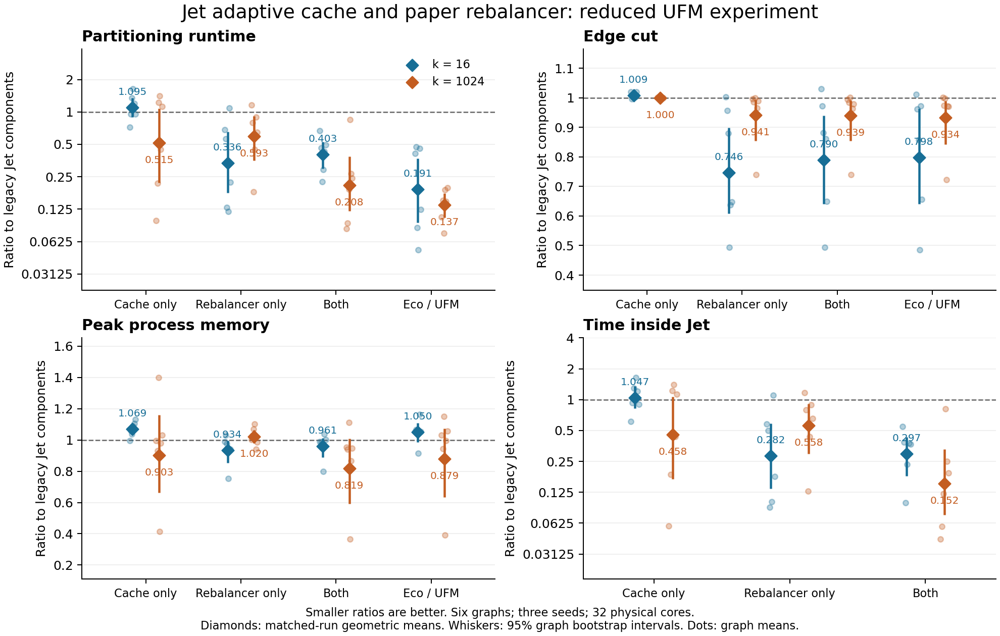

# Jet adaptive cache and paper rebalancer: reduced UFM experiment

**Historical measurements:** every number and figure below measures runtime commit
`4cf985f27ebb6b48e8e5b5e4536d8f75e5e7fc5a`, before upstream Jet correctness fix
[#160](https://github.com/KaHIP/KaMinPar/pull/160) (`cff02fde`). The measured history,
including the report, is preserved at `codex/jet-measured-20261022` (`381f42ba`).
The implementation branch has since been rebased onto `29a86564` and retains #160:
zero-gain candidate and projected moves are accepted, candidate gains are reused,
cut changes are tracked incrementally, bound-violation sums use the unsigned range,
convergence and rollback locks are handled correctly, and refinement reports improvement.
Its sparse option now enumerates adjacent targets and falls back to on-the-fly
connectivity for unsorted input or unsafe packed weights. These changes can alter
search trajectories and running time. The recorded comparisons are evidence about
the frozen measured revision; they have **not** been rerun on the rebased implementation.
Frozen source hashes, raw measurements, and validation records below are unchanged.

Both new components were implemented in the separate `codex/jet-adaptive-gain-cache` worktree. The complete screening experiment contains **180/180 successful, balanced measurements** on six UFM corpus graphs, two k values, three seeds, and five configurations, using 32 physical cores on `dijkstra`. The final batch completed normally (job 84399, exit 0, no restart).

Compared with the legacy Jet components, the combination is **2.48× faster at k=16 and 4.82× faster at k=1024**, with geometric-mean cut reductions of **20.98% and 6.08%**. All 36 matched combined runs are faster, although 6 have worse cuts. The rebalancer produces the more consistent improvement; the adaptive cache helps principally at large k. Eco/UFM remains faster on the aggregate, at similar aggregate cut quality.

## Component comparisons

The following are geometric means of 18 matched graph/seed ratios per k. Speedup above 1 is faster; negative cut and memory changes are improvements. Memory is whole-process peak RSS. The reference is Jet with the sparse cache and legacy overload balancer.

| k | Configuration | Runtime speedup | Cut change | Peak RSS change |
| ---: | --- | ---: | ---: | ---: |
| 16 | Cache only | 0.91× | +0.88% | +6.89% |
| 16 | Rebalancer only | 2.97× | -25.39% | -6.56% |
| 16 | Both | 2.48× | -20.98% | -3.85% |
| 1024 | Cache only | 1.94× | -0.01% | -9.70% |
| 1024 | Rebalancer only | 1.69× | -5.91% | +2.04% |
| 1024 | Both | 4.82× | -6.08% | -18.15% |

The combined speedup has a 95% graph-bootstrap interval of **1.89–3.35×** at k=16 and **2.59–8.36×** at k=1024. This is a small, selected screening set, not evidence of full-corpus superiority.

At k=16, the rebalancer alone is the strongest measured Jet configuration on aggregate runtime and cut. Adding the adaptive cache to it increases runtime by **19.83%**, cut by **5.91%**, and RSS by **2.90%**. At k=1024, that same cache addition gives **2.86× speedup**, **0.18% lower cut**, and **19.78% lower RSS**. The small-k cache runtime intervals include no change. The measurements support keeping the switches independent; they do not establish a general automatic selection threshold.

With the legacy rebalancer, the cache has a geometric-mean runtime ratio of 0.751 across both k values, but the **sum of partitioning times increases by 6.57%**. Expensive regressions on `recomp_dna1GB_9` and `kron_g500-simple-logn19` offset gains elsewhere. A geometric-mean speedup therefore does not imply reduced total work for this batch.

## Comparison with Eco/UFM

Ratios below are combined Jet divided by Eco/UFM; smaller is better. Each row contains 18 matched pairs.

| k | Runtime ratio | Cut ratio | Peak RSS ratio |
| ---: | ---: | ---: | ---: |
| 16 | 2.113 | 0.9903 | 0.916 |
| 1024 | 1.515 | 1.0059 | 0.931 |

Thus combined Jet takes **2.11× and 1.52×** the Eco/UFM time at k=16 and k=1024, respectively. Across both k values it is 1.79× slower (95% graph-bootstrap interval 1.11–2.96×), with a cut ratio of 0.9981. This experiment does not show that the new Jet combination supersedes UFM.



[Vector PDF](final-v2/comparison.pdf). Diamonds are matched-run geometric means, dots are per-graph means over seeds, and whiskers are 95% graph-bootstrap intervals. All plotted ratios use the legacy Jet components as reference.

## Variation across graphs

The table gives the combined configuration, averaged geometrically across three seeds. Speedup is reference/candidate runtime; cut change is candidate/reference minus one.

| Graph | k | Speedup vs legacy Jet | Cut change vs legacy | Speedup vs Eco | Cut change vs Eco |
| --- | ---: | ---: | ---: | ---: | ---: |
| `Long_Coup_dt6` | 16 | 1.50× | +2.99% | 0.61× | +1.78% |
| `Long_Coup_dt6` | 1024 | 12.13× | -0.54% | 1.29× | -0.60% |
| `com-lj.ungraph` | 16 | 2.16× | -2.72% | 1.02× | +1.14% |
| `com-lj.ungraph` | 1024 | 10.82× | -1.50% | 1.64× | +1.21% |
| `kron_g500-simple-logn19` | 16 | 4.47× | -11.88% | 0.37× | +2.68% |
| `kron_g500-simple-logn19` | 1024 | 5.25× | +0.12% | 0.39× | +0.40% |
| `recomp_dna1GB_9` | 16 | 3.43× | -50.68% | 0.18× | +1.74% |
| `recomp_dna1GB_9` | 1024 | 1.18× | -25.97% | 0.22× | +2.51% |
| `recomp_sources1GB_9` | 16 | 2.34× | -13.85% | 1.07× | -11.36% |
| `recomp_sources1GB_9` | 1024 | 3.76× | -3.55% | 0.56× | -0.84% |
| `soc-flickr-und` | 16 | 2.02× | -35.10% | 0.25× | -1.08% |
| `soc-flickr-und` | 1024 | 4.11× | -2.00% | 0.81× | +0.90% |

The largest combined speedups over legacy Jet occur on `Long_Coup_dt6` and `com-lj.ungraph` at k=1024 (12.13× and 10.82×). The weakest is `recomp_dna1GB_9` at k=1024 (1.18×), where combined Jet is still 4.52× slower than Eco. At k=16, `Long_Coup_dt6` has a 2.99% cut regression despite its speedup.

Cache selection can also change parallel search trajectories: on `recomp_sources1GB_9` at k=16, adding the cache to the new rebalancer reduces runtime to 0.393× but increases cut to 1.351×. The sparse-cache cuts stay around 10.8–11.1 million across seeds; adaptive-cache cuts range from 10.9 to 17.8 million. This is not an isolated cache-access timing comparison.

## Where time changes

Across the 18 large-k cases, summed move-selection time falls from **656.4 s to 4.4 s** when the adaptive cache replaces the legacy cache under the overload balancer. This treatment also replaces all-k traversal with adjacent-block traversal. Over the same cases, move-execution time rises from **39.8 s to 208.2 s**, and rebalancing time from **783.0 s to 1095.7 s**.

With the sparse cache, replacing the rebalancer reduces summed rebalancing time from **526.3 s to 66.0 s** at k=16 and **783.0 s to 173.5 s** at k=1024. These phase totals describe both the cost and amount of executed work; they do not isolate per-operation costs. Full timer maps and totals are retained in the manifest and summary.

## What was compared

This section describes the frozen measured revision, including its old all-block sparse traversal.

The four Jet configurations differ only in the two explicit switches below. They all use the same candidate executable. Eco is the repository's unconstrained LP + UFM preset, included as a separate runtime/quality reference.

| Name | Gain cache | Rebalancer |
| --- | --- | --- |
| Legacy components | `sparse` | `overload` |
| Cache only | `jet` | `overload` |
| Rebalancer only | `sparse` | `jet` |
| Both | `jet` | `jet` |

The switches are `--r-jet-gain-cache` and `--r-jet-balancer`, with `-P jet`. The new components are Jet's defaults. [Implementation notes](../../jet-refinement.md) describe the adaptive table sizes, weak and strong bucket passes, and safeguards for weighted vertices and minimum block weights.

The cache treatment includes both adaptive table sizing and iteration over adjacent blocks in Jet's move selection. The legacy treatment retains its all-block loop. These measurements therefore do **not** isolate the effect of table capacity alone. All Jet arms share the new bound-aware best-partition acceptance/rollback correction; the legacy arm is an ablation baseline, not an unchanged pre-patch executable. Parallel execution is nondeterministic, so equal seeds do not imply identical move sequences or search effort.

## Experimental design

The fixed screening set contains six graphs from `/nfs/work/graph_benchmark_sets/ufm_paper/combined`:

| Graph | Vertices | Undirected edges |
| --- | ---: | ---: |
| `Long_Coup_dt6` | 1,470,152 | 42,809,420 |
| `com-lj.ungraph` | 4,036,538 | 34,681,189 |
| `kron_g500-simple-logn19` | 524,288 | 21,780,787 |
| `recomp_dna1GB_9` | 3,233,125 | 25,285,086 |
| `recomp_sources1GB_9` | 2,792,175 | 12,188,301 |
| `soc-flickr-und` | 1,715,255 | 15,555,041 |

For each graph: k in {16,1024}, seeds in {1,2,3}, and five configurations, giving 180 invocations. All use epsilon=0.03 and 32 physical cores. Graph/k/seed cells were deterministically shuffled; all five configurations of a cell ran adjacently, with cyclic/reversed order balancing. The timeout was 300 seconds per invocation. Input copies were staged in shared memory, and file hashes were checked. All selected inputs have unit vertex weights; the original edge weights are retained.

The experiment ran in one exclusive allocation on `dijkstra`, with two Intel Xeon E5-2683 v4 CPUs, 32 physical cores and 64 logical CPUs. The job reserved the whole node and pinned execution to one logical CPU per physical core. The candidate was built with GCC 13.3.0, Release `-O3 -DNDEBUG`, native tuning, 32-bit node IDs, and 64-bit edge IDs and weights. Timers were enabled; sanitizers and heap/page profiling were disabled. Full configuration, dependency hashes, processor details, and affinity are recorded with the results.

Runtime is the program's partitioning time, excluding input/output. Jet time is the sum of the per-level Jet timer roots, without adding their descendants again. Peak RSS comes from a fresh one-child resource wrapper for each process; it includes graph loading and all other partitioner structures, and is not isolated cache memory. Exact exported block sizes are checked against `floor(1.03 * ceil(n/k))`, with exactly k entries and a total of n vertices. Cuts are the partitioner's reported cuts.

The tables use geometric means of matched graph/k/seed ratios. Speedup is reference time divided by candidate time; cut change is 100 times (candidate/reference - 1). The figure also shows each graph's mean across its three seeds and 95% percentile intervals from 2,000 graph-bootstrap samples (seed 42), keeping each graph's seed observations together. These intervals describe variation within this six-graph screening set; graph selection was not random, and the results do not establish full-corpus superiority.

## Validation and provenance

At the measured revision, all 22 Jet tests passed in the ordinary Debug/heavy-assertion build and in separate AddressSanitizer + UndefinedBehaviorSanitizer builds with both 32-bit and 64-bit weights/edge IDs. Tests cover adaptive sizing/growth, collision-chain deletion, concurrent updates, barrier-separated reads, full-width edge weights, weak/strong rebalancing, nonuniform and minimum bounds, infeasible weighted packing, CSR/compressed graphs, all four configurations, and rollback. No sanitizer diagnostics were reported. The cluster preflight also passed ten edge-weighted smoke invocations (five configurations at k=2 and k=16); weighted vertices and minimum bounds are covered by the local tests.

Runtime source commit: `4cf985f27ebb6b48e8e5b5e4536d8f75e5e7fc5a`, based on `7679b10946c9d13c0daa2caf18ee78ed81321350`. All 699 checked non-documentation/non-experiment source files, including all 11 changed runtime/test files, matched both committed blobs and the frozen source snapshot. The separate worktree excludes unrelated changes in the original checkout.

Final executable SHA256: `54e784046f1f2eab232d6b3caaa550f50224444ae71b9f98b62a473c48d38a62`. Final source-tree SHA256: `7016825e8d8d7e88d4b9939d13753303029cbcb76e184e262bad39016849fdc7`. Build job: 84398. Measurement job: 84399.

The earlier pilot used query locks that were unnecessary during Jet's barrier-separated read phases. It was deliberately stopped after 29 complete invocations and one interrupted invocation. Its exact records are preserved in `pilot-v1.tar.gz` (and unpacked locally under `pilot-v1/`); none contributes to the final results. The final implementation was adjusted after this pilot, so this is a screening experiment rather than held-out confirmation. An earlier setup attempt failed before its first measured call because the node lacked `/usr/bin/time`; the final runner uses the per-process resource wrapper instead. This failed setup is preserved in `attempt84392-missing-time.tar.gz`.

`final-v2/plan.json` records input hashes, exact commands, order, hardware/build provenance, and the runner hash. `runs.jsonl` and `runs.csv` contain every measurement. Raw logs, exact block-size files, resource measurements, smoke inputs/results, and build records are retained in `final-v2/raw-evidence.tar.gz`, with unpacked local copies. Local test logs are retained in `validation-logs.tar.gz`. `archives.json` records each archive and member hash; archive contents were verified against the original bytes. Replaying the audit from a fresh extraction reproduced the original audit exactly; see `validation/analysis-validation.json`. The measured executable and TBB libraries are archived on the cluster; `final-v2/binary-archive.json` records their locations and hashes. `independent-audit.json` records a second read of those files, their hashes, command identity, reported k, accepted status, and exact balance checks. This audit shares the runner's parsing functions; it is not a separate cut recomputation. The corrected auditor was checked against valid, wrong-k, non-OK-status, and timeout fixtures. Slurm accounting history is unavailable on this cluster, so the terminal scheduler record comes from `scontrol`. Cleanup job 84414 verified the six staged graph hashes and removed only those copies (2,347,939,782 bytes) and their empty directory; the corpus and remote experiment evidence remain intact.

## Reproducing the analysis

From the repository root, with Python 3 and Matplotlib available:

```sh
tar -xzf docs/experiments/jet-adaptive-20261022/final-v2/raw-evidence.tar.gz -C docs/experiments/jet-adaptive-20261022/final-v2
python3 scripts/experiments/jet_audit_results.py docs/experiments/jet-adaptive-20261022/final-v2 --runner scripts/experiments/jet_reduced_ufm.py
python3 scripts/experiments/jet_reduced_ufm.py report --root docs/experiments/jet-adaptive-20261022/final-v2
MPLCONFIGDIR=/tmp/jet-mpl python3 scripts/experiments/plot_jet_reduced_ufm.py docs/experiments/jet-adaptive-20261022/final-v2
```

The build and measurement Slurm scripts in `scripts/experiments/` record the cluster configuration. Their dependency/compiler paths are specific to this cluster. Use a fresh experiment directory for a new run; the runner rejects changed configuration or duplicate/unrecorded invocations rather than silently mixing results.
