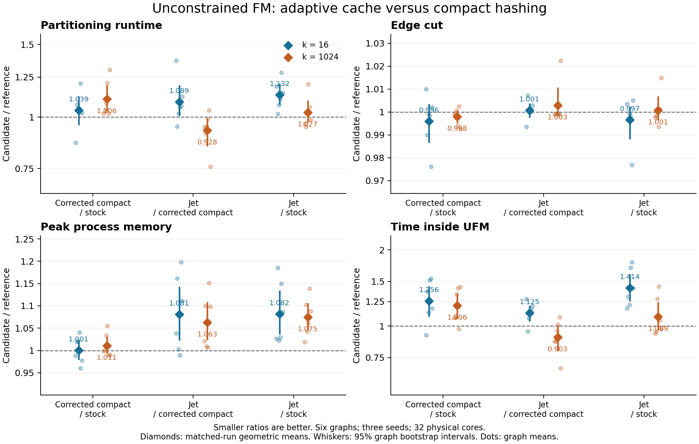

# Adaptive Jet gain cache in unconstrained FM

Keep compact hashing as the UFM default. On this reduced six-graph study, the adaptive Jet cache improves large-k runtime relative to corrected compact hashing, but regresses small-k runtime and increases peak process memory. The selectable prototype remains on `codex/ufm-jet-gain-cache`; `--r-fm-gc jet` opts in. The strategy default is unchanged, although the branch also corrects delta-cache handling shared by both candidate strategies.

All aggregate percentages below use matched-run geometric means unless stated otherwise. At k=1024, Jet reduces total partitioning time by **7.21%** and time inside UFM by **9.74%** versus corrected compact hashing. At k=16 it increases those times by **8.92%** and **12.54%**. Peak RSS rises **6.30%** and **8.07%**, respectively. Across both k values, total runtime is essentially unchanged (**+0.53%**) while RSS rises **7.18%**. Against unchanged stock UFM, the Jet prototype is **13.21% slower at k=16** and **2.68% slower at k=1024**. These measurements do not support making it the UFM default.

All **108/108 primary runs** and **9/9 edge-weighted smoke runs** passed. Exact block-size checks found every primary result feasible. Measurement job `84428` completed with exit `0:0` in **18m52s** on an exclusive dijkstra allocation. No runs were dropped, retried, timed out, or replaced.



## Matched comparisons

Ratios are candidate/reference geometric means; smaller is better. Each per-k row contains 18 matched graph/seed pairs. Runtime is total partitioning time excluding input/output; RSS is peak memory for the whole process. Edge cut is the executable-reported weighted cut.

| Comparison | k | Runtime | Cut | Peak RSS | UFM time |
|---|---:|---:|---:|---:|---:|
| Corrected compact / stock | 16 | 1.0394 | 0.9959 | 1.0008 | 1.2561 |
| Jet / corrected compact | 16 | 1.0892 | 1.0007 | 1.0807 | 1.1254 |
| Jet / stock | 16 | 1.1321 | 0.9966 | 1.0815 | 1.4136 |
| Corrected compact / stock | 1024 | 1.1065 | 0.9979 | 1.0109 | 1.2061 |
| Jet / corrected compact | 1024 | 0.9279 | 1.0029 | 1.0630 | 0.9026 |
| Jet / stock | 1024 | 1.0268 | 1.0008 | 1.0746 | 1.0886 |

The common delta-cache corrections and snapshot adapter cost 7.24% total runtime and 23.09% UFM time overall relative to stock, with a 0.31% lower cut. This includes changes in search work and optimization trajectory; it is not a measurement of snapshot-copy overhead alone. Jet versus stock combines that common effect with the cache substitution.

For Jet/corrected compact, graph-bootstrap 95% runtime intervals are [1.0069, 1.1976] at k=16 and [0.8487, 0.9923] at k=1024. The overall interval [0.9528, 1.0672] straddles parity. These are descriptive intervals over six preselected graphs, preserving each graph's seeds; they do not establish a full-corpus result.

## Variation across graphs

Jet beats corrected compact in 4/18 individual runtime pairs at k=16 and 13/18 at k=1024. The strongest large-k result is `soc-flickr-und`: 24.26% lower runtime accompanies 2.24% higher cut. The other five large-k graph means have slightly lower cuts, so the aggregate cut increase is driven by this outlier. At small k, `Long_Coup_dt6` regresses by 37.13% in runtime.

Each row below is the geometric mean across three seeds for Jet/corrected compact.

| Graph | k | Runtime | Cut | Peak RSS |
|---|---:|---:|---:|---:|
| Long_Coup_dt6 | 16 | 1.3713 | 0.9935 | 1.0385 |
| Long_Coup_dt6 | 1024 | 0.9449 | 0.9989 | 1.0211 |
| com-lj.ungraph | 16 | 0.9489 | 1.0071 | 1.1619 |
| com-lj.ungraph | 1024 | 0.9131 | 0.9993 | 1.1002 |
| kron_g500-simple-logn19 | 16 | 1.0194 | 1.0000 | 1.0026 |
| kron_g500-simple-logn19 | 1024 | 0.9503 | 0.9990 | 1.0088 |
| recomp_dna1GB_9 | 16 | 1.0554 | 0.9999 | 0.9891 |
| recomp_dna1GB_9 | 1024 | 0.9910 | 0.9993 | 1.0064 |
| recomp_sources1GB_9 | 16 | 1.0632 | 1.0008 | 1.1979 |
| recomp_sources1GB_9 | 1024 | 1.0375 | 0.9987 | 1.1513 |
| soc-flickr-und | 16 | 1.1218 | 1.0029 | 1.1113 |
| soc-flickr-und | 1024 | 0.7574 | 1.0224 | 1.0988 |

The sum of total partitioning times is 317.553 s for Jet versus 324.216 s for corrected compact (2.05% lower). This weights expensive cases more heavily and is distinct from the paired geometric-mean runtime ratio of 1.0053 used above.

## What the timers show

These are summed phase seconds over 18 runs at each k, not geometric-mean ratios. Timer roots are summed over levels without counting descendants twice. The direct gain-cache initialization timer is available for both strategies; internal compact-cache subphase timers are not available for Jet.

| k | Arm | UFM total | Cache initialization | Fine-level searches | Rebalancing | Rollback |
|---:|---|---:|---:|---:|---:|---:|
| 16 | stock | 20.505 | 0.455 | 6.468 | 6.020 | 4.029 |
| 16 | compact | 27.248 | 0.451 | 8.757 | 7.654 | 5.590 |
| 16 | jet | 30.157 | 1.513 | 8.763 | 8.295 | 6.483 |
| 1024 | stock | 122.075 | 1.304 | 47.105 | 32.897 | 21.685 |
| 1024 | compact | 151.191 | 1.286 | 64.552 | 29.916 | 26.829 |
| 1024 | jet | 146.268 | 3.246 | 54.951 | 20.859 | 37.622 |

Jet initialization takes more time at both k values. At large k, lower fine-level-search and rebalancing totals accompany higher rollback time. The run does not isolate lock contention, probe costs, or per-operation throughput; changed search trajectories also change the amount of work.

Both caches expose adjacent move targets. Compact hashing scans degree-bound hash rows or all k entries in dense rows; Jet scans its adaptive row capacity. The prototype also uses full-width entries, per-row metadata, query locks, and retained initial slices after row growth. These costs are plausible reasons that smaller tables do not imply lower whole-process RSS here, but this experiment does not attribute memory to individual structures. A useful follow-up would test adaptive capacities within the compact entry encoding and profile the shared delta adapter before considering a default change.

## Frozen implementations and setup

| Arm | Source | Selection |
|---|---|---|
| Stock | `183e170ba396c66bc380d20b09b6928bbb55c000` | `-P eco --r-fm-gc compact-hashing` |
| Corrected compact | `8137ef90bd99550d4d6d795af7228667dd56b0ee` | `-P eco --r-fm-gc compact-hashing` |
| Adaptive Jet | same candidate executable as corrected compact | `-P eco --r-fm-gc jet` |

The candidate uses the locked FM Jet adapter and fixes the common large-k delta cache: all touched connections are tracked, delta-only targets use the correct connectivity/gain semantics, cancelled connections are omitted, targets are deduplicated, and consumer callbacks run after a shared row snapshot releases its lock. The two candidate arms differ only in cache selection. The subsequent test-only fix `77b20ee3` in Jet PR #162 was cherry-picked as `415fadc6`; it changes neither measured runtime source nor the frozen binaries.

Both immutable source archives were built with GCC 13.3.0, Release `-O3 -DNDEBUG`, native tuning, 32-bit vertex IDs, 64-bit edge IDs/weights, and timers enabled. Compiler commands match after path normalization, dependency hashes match, and source/binary hashes were unchanged after measurement. The machine has two Intel Xeon E5-2683 v4 sockets; the runner pins to one logical CPU on each of 32 physical cores. The exclusive reservation covers all 64 logical CPUs.

The fixed subset contains six graphs, k=16/1024, seeds 1–3, and epsilon 0.03. All primary graphs have unit vertex weights; weighted edges are preserved. All arms for a graph/k/seed cell run consecutively, with the six possible arm orders balanced across the 36 cells. Each call has a 300-second timeout. Full commands, inputs, hashes, compiler configuration, and CPU affinity are retained in the [plan](results/plan.json), [hardware record](results/hardware-84428.json), and build provenance. See [METHODS.md](METHODS.md).

| Graph | Vertices | Undirected edges | Edge-weighted |
|---|---:|---:|---|
| Long_Coup_dt6 | 1,470,152 | 42,809,420 | no |
| com-lj.ungraph | 4,036,538 | 34,681,189 | no |
| kron_g500-simple-logn19 | 524,288 | 21,780,787 | no |
| recomp_dna1GB_9 | 3,233,125 | 25,285,086 | yes |
| recomp_sources1GB_9 | 2,792,175 | 12,188,301 | yes |
| soc-flickr-und | 1,715,255 | 15,555,041 | no |

## Validation and evidence

Local validation passed 153 distinct Debug/heavy tests and 93 distinct 64-bit ASAN/UBSAN tests, including delta-cache oracle regressions, CSR/compressed representations, weighted graphs, parallel workers, both UFM rollback paths, and constrained-FM option dispatch. A separate Jet-PR mixed-width Release/ASAN/UBSAN run passed 121 tests after correcting a pre-existing test-helper parameter that narrowed 64-bit weights to 32-bit edge IDs. Sanitizer tests are not evidence of race freedom.

The [raw-log audit](results/independent-audit.json) rechecks all 108 records, recorded binary hashes against the plan, raw-log hashes, cache selections, resource records, and exact block sizes. Actual binaries are rehashed in [end-state verification](end-state-verification.json). An independent recomputation validates the paired ratios. Exact balance is checked from block weights; cut values are reported by the executable, not independently recomputed from saved partitions. Parallel scheduling and iteration order remain sources of variation.

The [archives manifest](archives.json) lists byte-exact members and SHA-256 hashes. `raw-evidence.tar.gz` contains raw output, block counts, RSS records, build logs, smoke cases, terminal scheduler records, and cleanup evidence. `validation-logs.tar.gz` contains local validation logs. Extract both into this directory to reproduce the audit. Slurm accounting is disabled; saved terminal `scontrol` records establish completion. Cleanup job `84432` removed only six hash-verified staged graph copies (2,347,939,782 bytes); original corpus hashes remain unchanged. Remote sources, binaries, and results remain under `/nfs/work/seemaier/experiments/ufm-jet-cache-20261022`.

Reproduce analysis from the repository root after extracting the archives (Python 3; Matplotlib for the figure):

```sh
python3 scripts/experiments/ufm_jet_cache_audit.py docs/experiments/ufm-jet-cache-20261022/results \
  --runner scripts/experiments/ufm_jet_cache.py
python3 scripts/experiments/ufm_jet_cache.py report \
  --root docs/experiments/ufm-jet-cache-20261022/results
python3 scripts/experiments/analyze_ufm_jet_cache.py \
  docs/experiments/ufm-jet-cache-20261022/results
MPLCONFIGDIR=/tmp/ufm-jet-mpl python3 scripts/experiments/plot_ufm_jet_cache.py \
  docs/experiments/ufm-jet-cache-20261022/results
```

The [implementation notes](../../ufm-jet-gain-cache.md) document the selectable adapter and concurrency constraints. The [earlier Jet-refinement study](../jet-adaptive-20261022/README.md) is a different, historical experiment; none of its timings are reused here.
